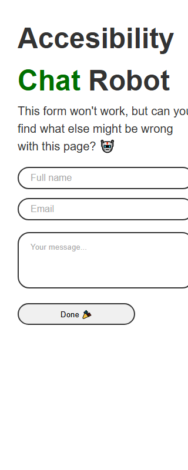

# GOV.UK holiday entitlement UI tests

A functional UI test suite for [Calculate holiday entitlement](https://www.gov.uk/calculate-your-holiday-entitlement),
using **Playwright, Cucumber and TypeScript**.

The suite covers regular and irregular workers, full and partial leave years, calculation boundaries, invalid inputs,
keyboard journeys, mobile reflow, automated WCAG 2.2 AA scans, GOV.UK search and navigation. All 46 original test IDs
are retained; ACC-05 adds axe-core scans and search/navigation add five more cases.

## Requirements

- Node.js **22 or later**; Node.js 24 was used for local verification.
- npm and network access to GOV.UK.
- Playwright-managed browsers, or an installed Chrome/Edge browser.

Dependencies are pinned in `package-lock.json`. Cucumber owns test execution; a separate Playwright Test
runner/configuration is not needed.

## Install, check and run

### Launch and audit the local page

```sh
npm install
npm start
```

Open [http://localhost:8080/](http://localhost:8080/). In another terminal, run
`npm run test:local:running` to audit that session. Alternatively, stop the server and run
`npm run test:local` to start it, run the local Cucumber accessibility suite and stop it automatically.
`npm run test:local:smoke` verifies launch/assets and keyboard entry only.

The supplied page currently has accessibility defects, so the full audit correctly exits nonzero.
See [the accessibility findings and bug report below](#local-page-accessibility-findings-bonus-task).
The [local audit guide](docs/local-accessibility.md) includes additional screenshots, Allure commands
and Jenkins behavior. GOV.UK tests remain a separate target.

### GOV.UK suite

Run these commands from the repository root:

```sh
npm ci
npx playwright install chromium
npm run check
npm run build
npm test
```

`npm run check` needs no browser. It runs ESLint (including floating-promise detection), Prettier, strict TypeScript,
the unit tests and complete Gherkin binding/ID validation. `npm run build` compiles the framework into `dist/`; normal Cucumber runs execute TypeScript through
`ts-node` in transpile-only mode. Strict typechecking is a separate required check, which avoids running a compiler
inside every browser worker.

On Linux CI machines, install browser system dependencies with:

```sh
npx playwright install --with-deps chromium
```

### Use installed Chrome on Windows

```powershell
$env:BROWSER = 'chromium'
$env:CHANNEL = 'chrome'
$env:PARALLEL = '0'
npm test
```

The `local` profile (`env/.env.local`) runs headed Chromium with one worker and no retries; see
[Configuration](#configuration). No command suppresses test failures; failed assertions
return a nonzero exit code.

## Local page accessibility findings (bonus task)

Assessed on **1 November 2026**, at `http://localhost:8080/`, using Windows, Chromium 156.0.8078.4,
Playwright 1.64.1 and axe-core 4.14.0. Checks included an automated audit, keyboard entry, populated
fields and a 320 CSS pixel viewport. External fonts and Iconify were blocked for repeatability,
so the recorded screenshots use the fallback font.

### Issues found

1. **Missing page title.** The page has no `<title>` and `document.title` is empty. Users cannot
   easily identify it in browser tabs or history. Add a descriptive title. **WCAG 2.4.2**;
   confirmed by axe's `document-title` rule.
2. **Missing document language.** `<html>` has no `lang` attribute, leaving assistive technology
   without the default pronunciation language. Add `lang="en"`. **WCAG 3.1.1**;
   confirmed by `html-has-lang`.
3. **Robot image has no alternative text.** The image has neither `alt` nor an accessible name.
   Add appropriate alternative text, or `alt=""` if the illustration is decorative.
   **WCAG 1.1.1**; confirmed by `image-alt`.
4. **Fields lack persistent visible labels.** Full name, Email and Your message use placeholders
   only; all three prompts disappear when values are entered. Add visible `<label>` elements
   associated with their controls. **WCAG 3.3.2**; confirmed by LOCAL-04. Placeholder-derived
   accessible names do not replace persistent visible labels.
5. **Placeholder text has insufficient contrast.** Computed `rgb(170,170,170)` text against white
   has approximately **2.32:1** contrast, below the **4.5:1** requirement for normal-sized text.
   Darken the placeholders and retain visible labels. **WCAG 1.4.3**; checked separately from axe,
   which did not flag this issue in the recorded run.
6. **Content is clipped at 320px.** Fixed widths and hidden overflow push the form and illustration
   outside the viewport. Use a responsive layout without clipping. **WCAG 1.4.10**;
   confirmed by LOCAL-03 and detailed in the bug report below.
7. **Missing main landmark.** `<div id="main">` does not provide a main landmark; content is
   outside landmarks. Use `<main>`. Confirmed by axe's `landmark-one-main` and `region`
   **best-practice** rules, not counted here as separate proven WCAG failures.
8. **Missing level-one heading.** The page starts with `<h2>` and has no `<h1>`. Use a meaningful
   heading hierarchy. Confirmed by axe's `page-has-heading-one` **best-practice** rule.

Additional observations: the document lacks a viewport meta tag and HTML doctype. Clicking Done
raises `ReferenceError: submitForm is not defined`; the exercise explicitly states that the form
will not work, so this is a functional limitation rather than an additional accessibility finding.

**Verification result:** LOCAL-01 (assets and keyboard entry) passed; LOCAL-02 (axe audit), LOCAL-03
(reflow) and LOCAL-04 (persistent labels) failed. The axe audit found six rule types; the issue list
also includes the separately checked contrast, labels and reflow findings. Allure contains screenshots,
traces and the full axe JSON. Run `npm run test:local:running` while `npm start` is active, or use
`npm run test:local` to manage the server automatically. These defects correctly produce a nonzero exit code.

Criteria reference: [W3C WCAG 2.2](https://www.w3.org/TR/WCAG22/). Screen-reader testing, native 400%
zoom, actual mobile devices and external-font rendering remain manual checks; this audit does not
establish full accessibility conformance.

### Bug report: LOCAL-A11Y-001 — contact form clipped at 320px

| Field               | Details                                                                                |
|---------------------|----------------------------------------------------------------------------------------|
| Status              | Open                                                                                   |
| Severity / priority | High / P1                                                                              |
| Area                | Responsive accessibility                                                               |
| Environment         | Windows, Chromium 156.0.8078.4, viewport 320×800 CSS pixels                            |
| URL                 | [http://localhost:8080/](http://localhost:8080/)                                       |
| Requirement         | [WCAG 2.2 SC 1.4.10 — Reflow](https://www.w3.org/WAI/WCAG22/Understanding/reflow.html) |
| Automated coverage  | LOCAL-03 in `src/test/features/accessibility/local-app.feature`                                      |

**Preconditions:** Run `npm install`, then `npm start` from the repository root.

**Steps to reproduce:**

1. Open `http://localhost:8080/`.
2. Use browser developer tools to set the viewport to 320 CSS pixels wide and 800 pixels high.
3. Inspect the introductory text, form fields and illustration, then navigate the fields with Tab.

**Expected result:** Text and controls reflow within the viewport without lost content or horizontal
clipping. The complete form remains available to users on narrow displays or using magnification.

**Actual result:** The form spans x=30–330, extending beyond the 320px viewport. The robot image
spans x=390–1090 and is entirely offscreen. Text and field borders are visibly clipped, and hidden
overflow prevents ordinary scrolling to reveal the missing content.

**User impact:** Users cannot view the complete form and page content at narrow widths.

**Evidence:** LOCAL-03 fails with these measured bounds. Its Allure result includes a screenshot
and trace. The following image is a 320×800 viewport capture:



**Likely cause:** The form section has a fixed 800px width plus 30px padding; the controls and image
also use fixed widths. The image has a 60px left margin, while the page uses `overflow: hidden`.

**Suggested fix:** Use fluid widths and `box-sizing: border-box`, constrain controls and images to
the available width, stack the illustration below the form on narrow screens, remove clipping and
add a device-width viewport meta tag. Verify the fix at 320 CSS pixels and with native 400% zoom.

## Execution commands

| Command                          | Purpose                                                                    |
|----------------------------------|----------------------------------------------------------------------------|
| `npm test`                       | All executable UI scenarios, live, using the `ENV` profile (default local) |
| `npm run test:staging`           | The same suite with the `staging` profile                                  |
| `npm run test:contract`          | `@contract` scenarios replayed from recorded HAR files: no network needed   |
| `npm run test:contract:record`   | Re-record those HAR files from the live site                               |
| `npm run report:flaky`           | List scenarios that needed a retry in the last run                         |
| `npm run lint`                   | ESLint, including floating-promise and fixed-sleep rules                   |
| `npm run test:smoke`             | Five representative calculator/search smoke scenarios                      |
| `npm run test:parallel`          | Executable suite with two isolated workers                                 |
| `npm run test:browsers`          | Cucumber suite concurrently in Chromium, Firefox and WebKit                 |
| `npm run test:browsers:smoke`    | Live smoke scenarios concurrently in all three engines                      |
| `npm run test:browsers:contract` | Recorded-contract scenarios concurrently in all three engines               |
| `npm test -- --tags '@POS-04'`   | One original test case                                                     |
| `npm test -- --tags '@negative'` | Negative tests                                                             |
| `npm run test:failed`            | Only locations recorded in the last rerun file                             |
| `npm run test:dry-run`           | Discover executable scenarios; writes no report files                      |
| `npm run test:all:dry-run`       | Discover executable, manual and requirements-dependent cases               |
| `npm run check:steps`            | Reject undefined/ambiguous steps or missing original IDs                   |
| `npm run test:unit`              | Config, profile loading, HAR keys and entitlement-oracle unit tests        |
| `npm run test:framework`         | Chromium tests for the custom assertions, using local HTML                 |
| `npm run format:check`           | Check TypeScript/runner formatting                                         |
| `npm run format`                 | Apply formatting                                                           |
| `npm run debug`                  | Headed Playwright Inspector run                                            |

An empty/missing rerun file is reported as an error rather than treating zero tests as a successful rerun. Likewise,
`test:unit` and `test:framework` fail when their directory contains no tests. Rerun reports
use separate names so the primary execution report remains available.

Feature paths are supplied by the npm commands rather than `cucumber.cjs`. For a single feature (including IDE runs),
pass its path directly:

```sh
npx cross-env FORCE_COLOR=0 cucumber-js --config cucumber.cjs src/test/features/positive.feature
```

Use `FORCE_COLOR=1` to enable colors or `FORCE_COLOR=0` to disable them. Do not pass `colorsEnabled` in
`--format-options`.

For WebStorm Cucumber run configurations (and the Cucumber.js configuration template), set the working directory to the
project root, Cucumber arguments to `--config cucumber.cjs`, and environment variables to
`NODE_OPTIONS=--require ./scripts/webstorm-cucumber.cjs` and `FORCE_COLOR=1`. The preload translates the deprecated
color option injected by WebStorm into the environment variable before Cucumber parses it, preserving the IDE formatter
and scenario selection. These settings are applied to the local saved scenario and template in `.idea/workspace.xml`;
`.idea` is ignored by Git, so other checkouts need the same settings.

### Three browsers in parallel

```sh
npx playwright install chromium firefox webkit
npm run test:browsers:smoke
```

`npm run test:browsers` runs the full executable GOV.UK suite in **Chromium, Firefox and WebKit
at the same time**, using three independent Cucumber processes. `npm run test:browsers:contract`
replays the four recorded contracts in every engine without requiring the live site.

Each process prefixes console output with its browser name and writes isolated HTML, JSON, JUnit,
messages, rerun, Allure and evidence files under `test-results/cross-browser/<browser>/`.
Set `CROSS_BROWSER_REPORT_DIR` to change that root. Custom `ARTIFACTS_DIR` and `ALLURE_RESULTS_DIR`
are also separated by browser. Results are retained; clean each browser's Allure directory before
an independent run if you do not want previous results included.

The command waits for all three engines and exits nonzero if any engine fails. It runs headless
unless `HEADLESS=false` is explicitly set in the shell, and clears `CHANNEL` so Firefox/WebKit
cannot inherit a Chrome-only launch option. Concurrent HAR recording is rejected; record with
the existing single-browser `test:contract:record` command.

Cucumber flags apply to all three engines, for example:

```sh
npm run test:browsers -- --tags @POS-04
npm run test:browsers:smoke -- --parallel 2
```

Browser concurrency and scenario workers are separate: `--parallel 2` means up to **six scenario
workers** across three engines. Without that flag, each engine uses the profile's `PARALLEL`
setting. The original `test:parallel` still runs two workers in one selected browser.

To generate one browser's Allure report:

```sh
npx cross-env REPORT_DIR=test-results/cross-browser/chromium npm run allure:generate
npx cross-env REPORT_DIR=test-results/cross-browser/chromium npm run allure:open
```

Jenkins runs the live engines in parallel when `BROWSER=all`; its existing combined Allure/JUnit
publishing includes all three isolated results.

Verified locally on 1 November 2026: the parallel contract run passed all four scenarios in Chromium
and all four in WebKit. Firefox failed at launch because Windows is missing `msvcp140_1.dll`, so the
combined command correctly returned exit code 1 after waiting for the other engines. Install/repair
the [Microsoft Visual C++ x64 Redistributable](https://learn.microsoft.com/en-us/cpp/windows/latest-supported-vc-redist/)
before rerunning Firefox. Unit tests also verify simultaneous process startup, output isolation and
failure aggregation. Jenkins execution remains unverified on a controller.

### Other browser engines

Clear `CHANNEL` before selecting Firefox or WebKit:

```powershell
Remove-Item Env:CHANNEL -ErrorAction SilentlyContinue
npx playwright install firefox webkit
npm run test:firefox
npm run test:webkit
```

`CHANNEL=chrome` or `msedge` is valid only with `BROWSER=chromium`. Playwright WebKit provides engine coverage; it does
not establish testing in actual Safari or on a physical iPhone. Browser scripts run against the same scenarios and
assertions.

## Configuration

Settings come from four layers, highest precedence first:

1. Real environment variables (shell, CI, IDE run configuration).
2. A personal, git-ignored `.env` in the project root. Copy `.env.example`, which documents every variable with
   its allowed values, and uncomment only what you need: anything set there overrides every profile.
3. The committed profile `env/.env.<ENV>`: `local` (default, headed), `staging` or `ci` (headless, two workers,
   one retry). An unknown `ENV` fails immediately and lists the available profiles.
4. Defaults in `test-options.ts`.

`scripts/load-env.cjs` applies this order for every entry point. `test-options.ts` then validates every value
before a browser starts, so a typo fails fast with a precise message rather than mid-run.

| Variable                           | Default                  | Meaning                                                     |
|------------------------------------|--------------------------|-------------------------------------------------------------|
| `ENV`                              | `local`                  | Profile to load from `env/`                                 |
| `HOLIDAY_BASE_URL`                 | GOV.UK calculator URL    | Landing-page URL                                            |
| `BROWSER`                          | `chromium`               | `chromium`, `firefox` or `webkit`                           |
| `CHANNEL`                          | unset                    | Installed `chrome` or `msedge`                              |
| `HEADLESS`                         | `true`                   | Literal `true` or `false`                                   |
| `STEP_TIMEOUT`                     | `60000`                  | Maximum duration per Cucumber step, milliseconds            |
| `ACTION_TIMEOUT`                   | `10000`                  | Playwright action timeout, milliseconds                     |
| `NAVIGATION_TIMEOUT`               | `30000`                  | Navigation timeout, milliseconds                            |
| `EXPECT_TIMEOUT`                   | `5000`                   | Retrying assertion timeout, milliseconds                    |
| `BROWSER_WIDTH` / `BROWSER_HEIGHT` | `1280` / `800`           | Viewport dimensions                                         |
| `PARALLEL`                         | `0`                      | `0` runs serially; positive integers select workers         |
| `RETRY`                            | `0`                      | Scenario retries; every retry is listed by `report:flaky`   |
| `REPORT_DIR`                       | `test-results/cucumber`  | Report and rerun locations                                  |
| `ARTIFACTS_DIR`                    | `<REPORT_DIR>/artifacts` | Failure screenshots and traces                              |
| `TRACE`                            | `on-failure`             | `off`; `on-failure` keeps failing traces; `on-first-retry` traces only attempt 2 (needs `RETRY` ≥ 1; the `ci` profile's mode); `on` keeps all |
| `HAR`                              | `off`                    | `off`, `record` or `replay` for `@contract` scenarios        |
| `HAR_DIR`                          | `resources/har`          | Recorded HAR files, one per contract scenario ID            |

Start with one worker on resource-constrained machines; the public service and browser processes can be affected by
network and machine load.

## Reports and debugging

**Allure reporting is enabled for every executing profile.** Run `npm run allure:clean` before a new
independent run, then `npm test`, `npm run allure:generate` and `npm run allure:open` (Java 17+ required
for generation/viewing). Results and HTML live under `test-results/cucumber/allure-results` and
`allure-report`. See [Allure configuration, metadata, attachments, history and CI](docs/allure.md)
for all options, runtime API examples, portable HTML and report serving.

After a run, `test-results/cucumber/` holds `report.html` for people, `report.json` and `junit.xml` for tools, and
`messages.ndjson`, which `npm run report:flaky` reads. Failed scenarios attach a screenshot of every open page (popups included), the
scenario ID and attempt, URL, profile and browser/version metadata, plus a trace when `TRACE` recorded one. Evidence
files are named `<ID>-attempt<n>-<scenario>-<8 chars>`, for example `POS-04-attempt2-Full-year_entitlement-1a2b3c4d.zip`,
so a CI download sorts by test case.

Evidence never changes a scenario's outcome, by design. A passing scenario stays green and a failing one keeps its
original error; capture problems are attached and printed as `[evidence]` warnings instead. Every gap is explained in
the report: a renderer crash is reported even in a passing scenario, a failure with no open page says so, and a failed
screenshot (bounded by `ACTION_TIMEOUT`) attaches its reason. Tracing starts before any other set-up, so a Before hook
failure such as a missing HAR recording is still traced.

```sh
npx playwright show-trace test-results/cucumber/artifacts/<trace-file>.zip
```

`npm run test:failed` creates `rerun-report.*` files, so the primary report survives. Contract runs write
`contract-report.*`. Generated output and the personal `.env` are ignored by Git; the `env/` profiles and
`resources/har/` recordings are committed.

### Contract tests and HAR recordings

`@contract` scenarios (POS-01, POS-04, POS-11 and NEG-01) replay recorded GOV.UK responses. Anything not in the
recording is aborted rather than fetched, so the run is hermetic: it passes with the network blocked. A contract run
proves the tests and the recorded pages agree; it cannot detect a change to the live site, which is why the live suite
still runs nightly. Re-record with `npm run test:contract:record` after a deliberate live change, and review the diff.

## Architecture and responsibilities

```text
src/
  hooks/                     CustomWorld, typed ScenarioState and thin Cucumber lifecycle hooks
  support/                   Browser lifecycle, domain assertions, failure evidence, HAR contracts
  test/
    pages/
      BasePage.ts            Shared navigation and page landmarks
      BaseQuestionPage.ts    Common question, validation and answer-summary behavior
      BaseNumericQuestionPage.ts / BaseDateQuestionPage.ts
      PageManager.ts         Scenario-scoped page composition
      SearchPage.ts          Header search input and submission
      SearchResultsPage.ts   Result verification and opening a result
      *.ts                   Calculator pages, results and header-navigation objects
      components/            Cookies, answer summary, breadcrumbs and related guidance
    steps/                   Business-readable Cucumber step definitions
    features/                Journey and page-object scenarios
    test_data/               Fixed expected results and an independent entitlement oracle
env/                         Committed local, staging and ci profiles
resources/har/               Recorded responses for @contract scenarios
scripts/                     Profile loading, test runners, binding validation, reruns, flaky report
tests/unit/                  Config, profile precedence, HAR keys and oracle tests (no browser)
tests/framework/             Custom-assertion tests in Chromium against local HTML
```

All concrete page objects extend `BasePage`, directly or through the shared question, numeric and date bases. Shared
widgets use composition. `Calculator` orchestrates journeys and `PageManager` creates one lazy, cached instance of each
page per scenario. The calculator and navigation reuse those same instances. There are no global page fixtures or
singleton scenario state. See [the framework architecture and extension guide](docs/framework-architecture.md) for
responsibilities, inheritance and adding new pages.

### Reusing page steps

`page-questions.steps.ts`, `page-inputs.steps.ts` and `page-options.steps.ts` bind the calculator page classes through
the names in `page-targets.ts`. Numeric and date controls share one binding per operation; unknown page names fail with
the supported names. `result-page.steps.ts` covers result assertions/change controls, and `site-layout.steps.ts` covers
header, footer, feedback, breadcrumbs and topic navigation. Existing landing/search/journey steps are reused instead of
registering aliases for them. `BasePage`, `Calculator`, `PageManager` and the `Feedback` compatibility alias do not need
separate duplicate bindings.

For example, after reaching the weekly-days question:

```gherkin
Then the "days worked per week" calculator page should be displayed
When I fill "5" on the "days worked per week" numeric page
Then the "days worked per week" numeric page should retain "5"
When I continue from the "days worked per week" calculator page
Then the result page should be displayed
And the entitlement should be 28 days
```

Run the page scenarios with `npm test -- --tags @page_objects`. `npm run check:steps` rejects duplicate registered
expressions (even unused ones), then dry-runs every feature to reject undefined or ambiguous matches. The 14 expanded
scenarios in `page-objects.feature` cover calculator page selection, input retention/clearing, validation, results and
shared site content without submitting feedback.

Each worker owns a browser and each scenario owns a fresh context/page. Cleanup runs after failures. Locators prefer
accessible roles/labels and stable question keys. Search is scoped to the site-wide search form, while calculator inputs
are scoped to their own question form. The supplied outerHTML informed these selectors; generated IDs are not copied
into tests. Playwright auto-waiting and retrying assertions replace fixed sleeps.

Expected entitlement values are fixed independently of the UI in `Fixtures.ts`, using the linked GOV.UK guidance.
`EntitlementOracle.ts` implements the same statutory rules as pure functions, and a unit test asserts the two agree for
every fixture. Two independent derivations make a wrong expected value visible before it reaches a browser. The oracle
refuses inputs whose rule has not been confirmed (for example a mid-month starter) instead of guessing. Assertions
check the entitlement paragraph and units rather than finding any matching number elsewhere on the page.

Domain assertions live in `src/support/assertions.ts`: `toBeSmartAnswerForm`, `toHaveNoHorizontalScroll`,
`toFitWithinViewport` and `toPassAxe`, on top of Playwright's `expect` configured with `EXPECT_TIMEOUT`. Exact copy is
asserted only where wording is the requirement (legal rules, error messages); editorial hints are matched on their
substance.

## Coverage and deliberate limits

The default profile excludes `@manual` and `@requires_confirmation`: **75 executable scenarios** and **20
manual/requirements examples** are defined for GOV.UK. Four separate local-page scenarios bring the total to
**99 expanded scenarios**. The manual/requirements examples are explicitly
pending when selected, not counted as automated passes. See the feature README for details.

EDGE-08 now uses the full-year route for someone employed from the first day of the leave year. The part-year starter
route's requirement for an earlier leave-year start is covered explicitly by NEG-10, including correcting the error. The
former route mismatch is not treated as a known product defect.

Manual screen-reader and native 400% browser-zoom checks remain manual. Numeric limits/format contracts that were not
supplied and the actual-browser/device acceptance matrix remain requirements-dependent. Automated keyboard and 320px
reflow checks and the axe-core scans (ACC-05) complement, rather than replace, manual accessibility assessment:
automated tools detect only part of WCAG.

## CI and Docker

For Jenkins, use the root [Jenkinsfile](Jenkinsfile). It runs checks, framework/contract tests and
selectable live browser suites, publishes JUnit and Allure, and archives evidence after failures.
See [Jenkins setup and parameters](docs/jenkins.md) for the Linux Docker agent, plugins and Allure tool.

`.github/workflows/ui-tests.yml` runs three tiers with `ENV=ci`:

| Job        | Runs                                                     | Network | Signal                                          |
|------------|----------------------------------------------------------|---------|-------------------------------------------------|
| `static`   | `npm run check`                                          | no      | Lint, format, types, unit tests, step coverage  |
| `hermetic` | `test:framework`, `test:contract` in Chromium            | no      | A failure is a code change, never site noise    |
| `live`     | `npm test` on Chromium, Firefox and WebKit, one retry    | GOV.UK  | Real behaviour; retries are listed as flaky     |

Triggers are push, pull request, manual dispatch and a nightly schedule, because GOV.UK can change without a commit
here. The live jobs publish JUnit results as a check, add the flaky-retry table to the job summary and upload all
reports. A composite action caches Playwright browsers by locked version.

The Docker image version matches the pinned Playwright version and uses the `ci` profile:

```sh
docker compose build
docker compose run --rm ui-tests
BROWSER=firefox docker compose run --rm ui-tests
```

Docker and hosted CI configuration are supplied; local verification uses Windows. Those other environments must be
executed before claiming cross-browser acceptance.

## Verification

### Verified local result — 1 November 2026 (Windows, Node.js 24)

| Gate                                          | Result                                                      |
|-----------------------------------------------|-------------------------------------------------------------|
| `npm run check`                               | Passed: lint, format, strict types, 57 unit tests, 193 unique step patterns, 95 scenarios / 47 IDs bound |
| `npm run build`                               | Passed                                                      |
| `npm run test:framework`                      | 14 / 14 passed (Chromium, local HTML)                       |
| `npm run test:contract`                       | 4 scenarios, 25 steps passed from HAR; also passes with the network blocked |
| `ENV=ci npm test` (live, Chromium, 2 workers) | **75 scenarios, 608 steps passed** in 4 m 21 s              |
| `npm run report:flaky`                        | No scenario needed a retry                                  |

Observed during development, and why the tiers exist: two earlier live runs each had one scenario hit the 10 s action
timeout while GOV.UK was slow to respond. One passed on its CI retry, which the flaky report is designed to surface;
the trace of the other showed the next page arriving late. Neither was a product defect.

Not verified locally: Firefox and WebKit live runs, Docker, and the hosted GitHub Actions workflow. They are configured
and must be executed before claiming cross-browser or CI acceptance. The 20 manual/requirements examples are excluded
and never counted as automated passes.

The original assignment is retained in `docs/assignment.md`. The public calculator is the default target;
the local accessibility exercise has its own `test:local` commands and Jenkins stage.
