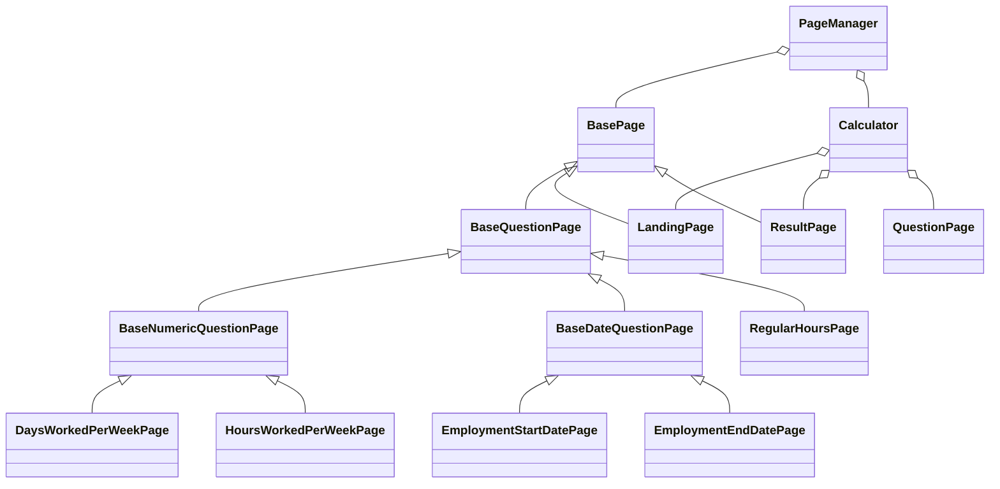

# Framework architecture

All concrete UI pages inherit `BasePage`, directly or through a question-specific base. `PageManager` and `Calculator`
compose pages: they are the scenario object registry and journey coordinator. Small controls (`RadioOptions`,
`CookieBanner`, `AnswerSummary`) remain scoped components rather than inheriting unrelated page behavior.



## Responsibilities

| Class                     | Owns                                                                                                          |
|---------------------------|---------------------------------------------------------------------------------------------------------------|
| `BasePage`                | Playwright page, main landmark, lazy cookie control, navigation/reload error checks, same-tab link navigation |
| `BaseQuestionPage`        | Scoped question form, heading/caption, Continue, validation, previous answers and restart                     |
| `BaseNumericQuestionPage` | Numeric input, fill/clear/retention, successful submission, numeric form configuration                        |
| `BaseDateQuestionPage`    | Day/month/year inputs, fill/clear/retention and successful submission                                         |
| Concrete pages            | Question keys, route-specific hints, options and assertions                                                   |
| `PageManager`             | Typed lazy page creation and instance reuse within one scenario                                               |
| `Calculator`              | Multi-page journeys using the same landing/question/result instances as `PageManager`                         |
| `CustomWorld`             | Guarded access to page objects; `required()` reads state an earlier step must have set                        |
| `ScenarioState`           | Typed data passed between the steps of one scenario; a fresh instance per scenario                            |
| `BrowserManager`          | One browser per Cucumber worker, isolated contexts, context timeouts, shutdown                                |
| `ScenarioArtifacts`       | Per-attempt screenshots of every open page and traces per `TRACE` mode; explains every gap; never changes an outcome |
| `HarContract`             | Routes `@contract` scenarios through a per-ID HAR recording when `HAR=record` or `replay`                     |
| `assertions.ts`           | Configured `expect` plus domain matchers: smart-answer form, reflow, viewport fit, axe WCAG 2.2 AA            |
| `EntitlementOracle`       | Pure statutory-rule calculations, cross-checked against the fixtures by unit tests                            |

## Adding a page

1. Extend the smallest suitable base. Pass a scoped form locator or stable question key to its constructor. Keep
   route-specific selectors in the concrete page.
2. Call `super.expectLoaded()` when adding readiness assertions. TypeScript requires an explicit `override` and rejects
   unused declarations/parameters.
3. Add the page to the typed `PageObjects` contract and expose a `PageManager` getter through `getOrCreate`. Do not
   introduce global page instances. Dependencies such as navigation/search and calculator/result should reference
   manager-owned instances.
4. Add a name to the relevant registry in `page-targets.ts` to reuse existing Gherkin bindings. Add a new step only for
   a distinct business action. Existing numeric/date method names remain available as readable domain aliases.
5. Add a deterministic DOM contract test when introducing shared behavior, and an appropriate feature example for the
   new journey.
6. Put data that later steps need in `ScenarioState` with a typed field, and read it with `world.required(...)`. Assert
   on what the page shows, never on values the test itself stored.

## Adding an assertion

Add a matcher to `assertions.ts` when the same multi-step check appears in more than one page or step. Matchers that
read page state use `pollUntilEqual`, so they retry like built-in web-first assertions and report a diff. Cover each
one in `tests/framework/assertions.test.ts` with a passing case, a failing case that checks the message, and `.not`.

`submitValue` and `submitDate` assert that a valid submission leaves the current form. For invalid inputs, fill the
field and call `continue` separately, then assert validation and retained values. This keeps rejection cases explicit.

## Verification

```sh
npm run check              # no browser: lint, format, types, unit tests, step coverage
npx playwright install chromium
npm run test:framework     # custom assertions against local HTML
npm run test:contract      # @contract scenarios from recorded HAR, no network
npm test                   # live suite
```

Guards against false greens: `test:unit` and `test:framework` fail when they find no tests; `test:failed` fails on an
empty rerun file; `check:steps` fails on undefined or ambiguous steps and on any missing scenario ID; ESLint rejects
un-awaited promises and fixed sleeps. Retries are never silent: `npm run report:flaky` lists every scenario that
needed one. See the README for the latest verified results.
