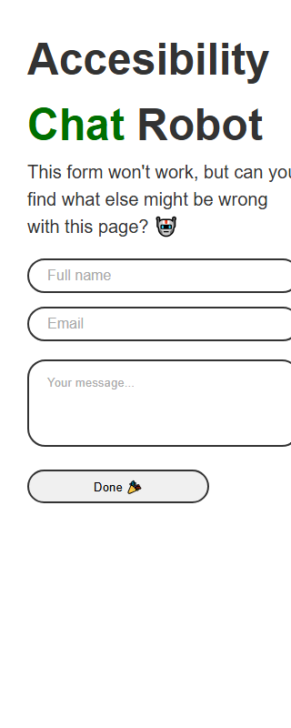
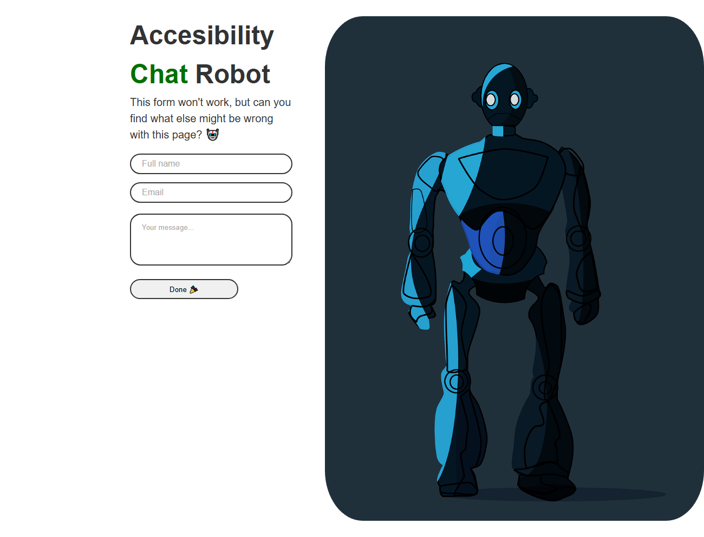

# Local page: launch, tests and accessibility findings

## Launch the supplied page

From the repository root:

```sh
npm install
npm start
```

Open [http://localhost:8080/](http://localhost:8080/). Stop the server with Ctrl+C.
The shared launcher serves `public/` on loopback port 8080 with caching disabled. It does not
serve the repository root. CI uses `npm ci` for the committed dependency lockfile.

## Automated verification

Install Chromium once with `npx playwright install chromium`, then use:

| Command | Behavior |
|---|---|
| `npm run test:local` | Start the server, run all four local Cucumber scenarios, stop the server and preserve the test exit code |
| `npm run test:local:smoke` | Start/stop the server and verify local HTML/CSS/image loading plus keyboard entry |
| `npm run test:local:running` | Run all four scenarios against an existing `npm start` session; leave that server running |

Managed runs fail if port 8080 is occupied; they never silently reuse another application's server.
The dedicated `local-app` Cucumber profile reuses CustomWorld, browser isolation, screenshots, traces,
JUnit and Allure. The GOV.UK profiles exclude `@local_app`, so `npm test` does not require localhost.
All-feature step validation includes the local scenarios.

Local checks run headless at 1280×800, with a separate 320×800 reflow check, no retries and failure
traces. External fonts and Iconify requests are blocked to make this audit independent of CDN/network
availability; screenshots show the fallback font. No accessibility rules are disabled and no known
violations are converted into passes. This is a launch/usability audit, not a working-form submission test.

Default evidence is under `test-results/local-app/` (override `REPORT_DIR` when needed):

- `report.html`, `report.json`, `junit.xml`, `messages.ndjson` and `rerun.txt`.
- `local-axe-results.json`: full axe results, including passes, violations and incomplete checks.
- `artifacts/`: failing-scenario screenshots and Playwright trace ZIPs.
- `allure-results/`: all scenarios and attachments, including the full axe JSON.

Generate/view the local Allure report after the audit, including when it exits with failures:

```sh
npx cross-env REPORT_DIR=test-results/local-app npm run allure:generate
npx cross-env REPORT_DIR=test-results/local-app npm run allure:open
```

Before an independent rerun, clear accumulated Allure results with
`npx cross-env REPORT_DIR=test-results/local-app npm run allure:clean`.

Jenkins always runs **Local accessibility**, even when `RUN_LIVE=false`, writes to
`test-results/jenkins/local-app`, publishes its JUnit and Allure results and archives the evidence.
The supplied defects currently make this stage and build **FAILURE**; subsequent test suites still run.
Fix the page and rerun to make the accessibility gate pass. The supplied HTML/CSS have not been changed.

## Verified findings — 1 November 2026

Windows, Playwright 1.64.1, Chromium 156.0.8078.4, axe-core 4.14.0. The browser launched and local
HTML, CSS and image loaded successfully. Keyboard order is name → email → message → Done; field
values persist and Done receives focus. This passing check does not establish screen-reader support.

| Scenario | Result |
|---|---|
| LOCAL-01 — assets and keyboard entry | Pass |
| LOCAL-02 — automated WCAG A/AA and best-practice audit | Fail: six rule types |
| LOCAL-03 — 320 CSS pixel reflow | Fail: form and illustration outside viewport |
| LOCAL-04 — labels after entering values | Fail: all three fields lack persistent visible associated labels |

Confirmed accessibility issues:

| Issue | Evidence and impact | Suggested correction |
|---|---|---|
| Missing page title | axe `document-title`; `document.title` is empty. Users cannot reliably identify the page in tabs/history. WCAG 2.4.2. | Add a descriptive `<title>`. |
| Missing document language | axe `html-has-lang`; `<html>` has no `lang`. Assistive technology lacks the default pronunciation language. WCAG 3.1.1. | Set `lang="en"`. |
| Robot image has no text alternative | axe `image-alt`; the image has neither `alt` nor an accessible name. WCAG 1.1.1. | Use meaningful alternative text if informative, or `alt=""` if decorative. |
| Labels disappear when fields are populated | Zero `<label>` elements; name, email and message use placeholders only. LOCAL-04 fails for all three. Users lose the visible field purpose. WCAG 3.3.2. | Add persistent visible labels associated using `for`/`id`. Placeholder-derived accessible names are not persistent visible labels. |
| Low-contrast placeholders | Computed placeholder color `rgb(170,170,170)` against white: approximately **2.32:1**, below 4.5:1 for normal text. This was checked separately; axe did not flag it in this run. WCAG 1.4.3. | Darken placeholder text and retain visible labels. |
| Clipped narrow layout | At 320px the form spans x=30–330 and image x=390–1090. Fixed widths and hidden overflow cut off controls/content. LOCAL-03 fails. WCAG 1.4.10. | Use responsive widths, stack content, and remove clipping. |

Additional navigation/structure findings from axe's **best-practice** rules (not three additional
proven WCAG failures): `landmark-one-main` and `region` identify the missing main landmark/content
outside landmarks; `page-has-heading-one` identifies a page starting at `<h2>` without `<h1>`.
`<div id="main">` does not create a main landmark. Use `<main>` and a meaningful heading hierarchy.

Related observations: the document lacks a viewport meta tag and HTML doctype; add both during
remediation and recheck actual mobile rendering. Clicking Done raises `ReferenceError: submitForm
is not defined`. The page explicitly says the form will not work, so this is recorded as a functional
limitation of the exercise, not counted as a separate WCAG violation. `type="email"` and appropriate
autocomplete values would improve the email/name controls.

Criteria reference: [W3C WCAG 2.2](https://www.w3.org/TR/WCAG22/). The automated scan does not prove
conformance. Screen-reader announcements, native 400% zoom, real mobile devices and external-font
rendering still need manual verification.

## Bug report: LOCAL-A11Y-001 — contact form is clipped at 320px

**Severity:** High. **Priority:** P1. **Status:** Open. **Area:** Responsive accessibility.
**Environment:** Windows / Chromium 156.0.8078.4; `http://localhost:8080/`; viewport 320×800 CSS pixels.
**Requirement:** [WCAG 2.2 SC 1.4.10 Reflow](https://www.w3.org/WAI/WCAG22/Understanding/reflow.html).

**Preconditions:** Install dependencies and run `npm start` from the repository root.

**Steps to reproduce:**

1. Open `http://localhost:8080/`.
2. Set the browser viewport to 320 CSS pixels wide using responsive developer tools.
3. Inspect the introductory text, contact fields and illustration, and navigate the fields with Tab.

**Expected:** Text and controls reflow within the viewport without lost content or horizontal clipping.

**Actual:** The form's right edge is at 330px, beyond the 320px viewport. The robot image begins at
390px and ends at 1090px, entirely offscreen. Text and control borders are visibly clipped.
The page's hidden overflow prevents ordinary scrolling to reveal the missing content.

**Impact:** People using narrow displays or magnification cannot view the complete form/content.

**Evidence:** LOCAL-03 fails with the measured bounds above. Its Allure entry includes the screenshot
and trace. The screenshot below is a 320×800 viewport capture, not an expanded full-page capture.



**Likely cause:** `.contact-form-section { width: 800px; padding: 30px; }`, fixed input/image widths,
the image's 60px left margin, and `.contact-page { overflow: hidden; }`.

**Suggested fix:** Use fluid containers with `box-sizing: border-box`, constrain controls/images to
available width, stack the illustration below the form at narrow widths, and remove hidden overflow.
Add a device-width viewport meta tag. Retest at 320px and native 400% zoom.

Desktop reference (1280px viewport, full-page capture):


